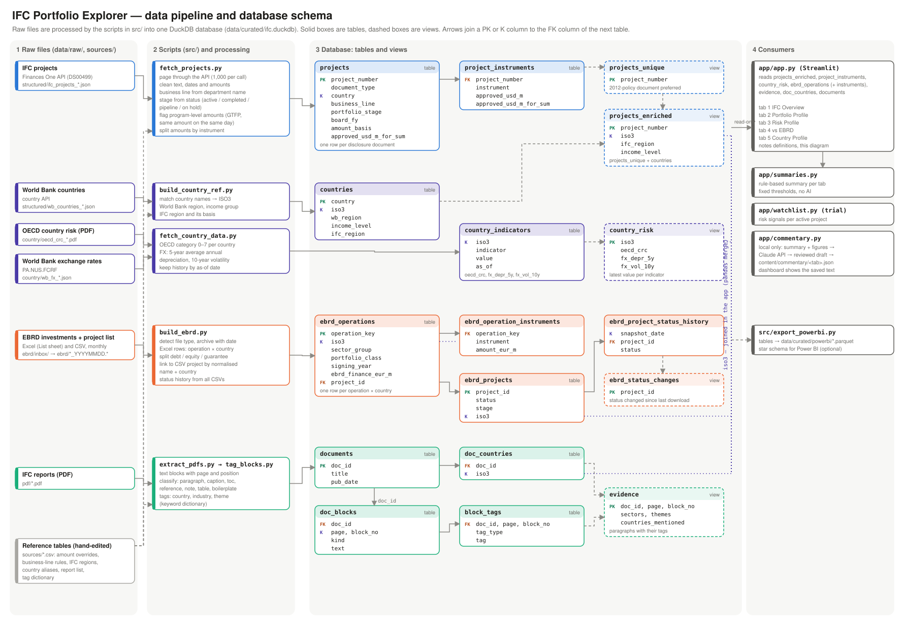

# IFC Portfolio Explorer

An interactive dashboard that combines IFC's structured project data with text from IFC publications,
so that investment figures and the qualitative context behind them can be read side by side.

The default view focuses on **Financial Markets (FIG) projects in the Middle East and Central Asia (MCT)**,
but every filter can be changed to cover other regions and industries.

## What it does

1. **Project data** – downloads all records from the *IFC Investment Services Projects* dataset
   (World Bank Group Finances One, dataset DS00499) through its public API, cleans them and stores them in DuckDB.
2. **Country reference** – attaches World Bank regions, income groups and lending categories
   (World Bank country API) and IFC regions to each project.
3. **Report text** – extracts the body text of IFC reports (PDF) paragraph by paragraph, with page numbers,
   handling multi-column layouts and removing headers, footers and boilerplate.
4. **Tagging** – tags each paragraph with countries, industries and themes using editable keyword dictionaries,
   so that paragraphs can be joined to projects by country and industry.
5. **Dashboard** – a Streamlit app that reads as one story, tab by tab: (1) the whole of IFC today, (2) what
   the portfolio in a chosen scope is made of, (3) where its risks concentrate, (4) how it compares with the EBRD
   in the same countries, and (5) one country in detail, with figures next to report text.

All tools and data sources are free. No paid AI or cloud services are used.

## Data flow



Each source is processed by a script in `src/` into one DuckDB database, which the dashboard reads; ISO3 country
codes link IFC projects, country risk, EBRD operations and report text. The same picture is shown on the
dashboard's *Notes on the data* tab. To change it, edit `docs/make_data_flow.py` and run
`uv run python docs/make_data_flow.py`.

| Step | Script | Main processing |
|---|---|---|
| IFC investment projects | `src/fetch_projects.py` | One row per project; program-level amounts set aside; business line from department; stage from status |
| World Bank country data | `src/build_country_ref.py` | ISO3 country codes; World Bank and IFC regions |
| OECD country risk | `src/fetch_country_data.py` | OECD category (0–7) per country |
| EBRD investments | `src/build_ebrd.py` | Files archived by date; Excel operations linked to the CSV project list by name and country |
| IFC reports | `src/extract_pdfs.py` → `src/tag_blocks.py` | Paragraphs with page numbers, boilerplate removed; country, industry and theme tags |
| Power BI (optional) | `src/export_powerbi.py` | Parquet files for Power BI |

### What each dashboard tab uses

| Tab | Database tables | Selection and amounts |
|---|---|---|
| 1 IFC Overview | `projects_enriched`, `project_instruments` | Whole of IFC. Active portfolio and pipeline now; new commitments by approval fiscal year (signed projects). |
| 2 Portfolio Profile | `projects_enriched`, `project_instruments` | Scope, fiscal years and stages from the sidebar. Approved amounts (US$m) by approval fiscal year. |
| 3 Risk Profile | `projects_enriched`, `project_instruments`, `country_risk` | Scope from the sidebar; all active projects. Approved amounts; OECD category of the project's country. |
| 4 vs EBRD | `projects_enriched`, `project_instruments`, `ebrd_operations`, `ebrd_operation_instruments`, `country_risk` | IFC signed projects by approval fiscal year (US$) vs EBRD net cumulative investment by year of first signing (€, converted at a rate set on the tab). Countries where both invested; IFC multi-country projects left out, EBRD regional operations included through the EBRD's own country allocation. |
| 5 Country Profile | `projects_enriched`, `project_instruments`, `country_risk`, `ebrd_operations`, `evidence` | One country; IFC figures follow the sidebar. EBRD investment in the same country; report paragraphs by theme. |

### How often each source is updated

| Source | Update | How |
|---|---|---|
| IFC investment projects | Whenever needed | `fetch_projects.py`, then `build_country_ref.py` |
| World Bank country classification | Once a year (July) | `build_country_ref.py` |
| OECD country risk classification | After each OECD review (several times a year) | `fetch_country_data.py` |
| EBRD investments and project list | Monthly | Files into `data/raw/ebrd/inbox/`, then `build_ebrd.py` |
| IFC reports | When a report is added | `sources/pdf_manifest.csv`, then `extract_pdfs.py` and `tag_blocks.py` |

Restart the dashboard after rebuilding the data; it caches data while running.

## Important notes on the data

- **Portfolio stages.** `portfolio_stage` groups project status: *Active portfolio* = signed and ongoing
  (Active, Pending Disbursement) — the current exposure that needs the closest monitoring; *Completed* = the track
  record; *Pipeline* = Pending Signing or Pending Approval (not yet a legal commitment; amounts may change or be
  missing); *On hold* = Hold.
- **Business lines (who).** `business_line` (FIG, MAS, INF, Funds & Tech, Equity Portfolio, Other) is derived from
  the department name with keyword rules in `sources/business_line_rules.csv`. Assumptions: the recorded department
  is the unit responsible at some point after approval (not necessarily the originating unit), and business lines
  stay stable across reorganisations. About 1.4% of projects are *Other*. `dept_name` is the department without
  its unit code and sub-unit (`dept_subunit`).
- **Instruments (how).** `project_instruments` splits each project's approved amount into loan, equity, guarantee
  and risk-management amounts from the source data (a project can use several). The source `product_line` label
  is not used for amounts, because it often disagrees with these figures.

- **Amounts are Board-approved amounts** (US$ millions). They are not disbursements or outstanding balances.
  The dataset also includes pipeline projects pending approval or signing.
- **Program-level amounts are excluded from totals.** For some programs, such as the Global Trade Finance
  Program (GTFP), the program-wide approval ceiling (e.g. US$7bn) is recorded against each participating bank.
  Summed naively, these records account for about 59% of all approved amounts in the dataset.
  A record is treated as program-level if its name starts with "GTFP", or if the same amount (US$100m or more)
  was approved on the same date for four or more projects. Borderline cases were checked against IFC's
  disclosure pages and overridden in `sources/amount_overrides.csv` (e.g. four unrelated US$100m loans
  approved on the same day are kept as individual projects). The column `approved_usd_m_for_sum` holds the
  amount used for totals, and `amount_basis` records the reason.
- **Disclosure documents vs. projects.** The source data has one row per disclosure document; 17 projects have
  two documents. Use the `projects_unique` view (one row per project) for any aggregation.
- **Fiscal years.** IFC fiscal years run July–June. `board_fy` is the fiscal year of Board approval, or of the
  projected Board date for pipeline projects not yet approved (`board_fy_basis` = Approved / Projected).
  Use `board_fy` for time filters; otherwise all projects pending approval drop out.
- **IFC regions.** Middle East and Central Asia follows the country list published on IFC's website ("Official").
  Tajikistan and North African countries are confirmed from the IFC regional department that handles their
  projects ("Confirmed (IFC department)"). Other countries are assigned provisionally from the World Bank region
  (`ifc_region_basis` shows which).
- **Current classifications.** World Bank regions and income groups are today's classifications, applied to all years.
- **Country risk.** `country_indicators` holds country-level data in one long format (country × indicator ×
  as-of date) so that new public sources can be added without changing the dashboard's structure. The first
  source is the OECD Country Risk Classification (0 = lowest, 7 = highest), parsed from the OECD's published PDF.
  The OECD produces it to set minimum premium rates for export credits and does not endorse other uses; the
  dashboard shows it with that caveat. High-income OECD and euro-area countries are not classified.
- **Keyword tagging** shows that a paragraph mentions a topic, not that the topic is its main subject.
  Tables of contents, footnotes, bibliographies, table rows, repeated paragraphs and boilerplate are
  excluded before tagging.

## Project structure

| Folder | Contents | In Git |
|---|---|---|
| `data/raw/pdf/` | Downloaded PDF reports (never modified) | No |
| `data/raw/structured/` | Raw API responses (JSON) | No |
| `data/raw/ebrd/` | EBRD files, dated (`inbox/` takes new downloads) | No |
| `data/extracted/` | Markdown conversions of PDFs (optional) | No |
| `data/curated/` | Cleaned data (Parquet, DuckDB) | No |
| `sources/` | Report register, reference tables and dictionaries (CSV) | Yes |
| `src/` | Data pipeline scripts | Yes |
| `notebooks/` | Exploration notebooks | Yes |
| `app/` | Streamlit dashboard | Yes |
| `content/commentary/` | Saved AI commentary (JSON), reviewed before saving | Yes |
| `docs/` | Data flow diagram (`data_flow.svg`) and the script that draws it | Yes |

Data files are not committed. Everything in `data/` can be rebuilt by re-running the scripts;
the origin of each report is recorded in `sources/pdf_manifest.csv`.

## Setup

Requirements: Python 3.14 and [uv](https://docs.astral.sh/uv/).

```bash
git clone https://github.com/hajimetagawa/ifc-dashboard.git
cd ifc-dashboard
uv sync            # creates .venv with the exact versions in uv.lock
```

## Running the pipeline

```bash
uv run python src/fetch_projects.py      # 1. project data from the Finances One API
uv run python src/build_country_ref.py   # 2. regions, income groups, IFC regions
uv run python src/extract_pdfs.py        # 3. text from PDF reports in data/raw/pdf/
uv run python src/tag_blocks.py          # 4. country / industry / theme tags
uv run python src/fetch_country_data.py  # 5. country risk data (OECD country risk classification)
uv run python src/build_ebrd.py          # 6. EBRD data (see "Updating the EBRD data")
uv run python src/export_powerbi.py      # 7. (optional) Parquet files for Power BI
uv run streamlit run app/app.py          # dashboard at http://localhost:8501
```

Useful options:

- `fetch_projects.py --input <raw.json>` re-processes a saved API response without calling the API.
- `build_country_ref.py --input <raw.json>` does the same for the World Bank country data.
- `extract_pdfs.py` only processes new or changed PDFs; `--force` re-processes all of them.
- `fetch_country_data.py --no-download` rebuilds the country data from the saved source files;
  `--download-only` only saves the latest source files to `data/raw/country/`.

After rebuilding the data, restart the dashboard (it caches data while running).

## Updating the EBRD data (monthly)

EBRD publishes two files on its [Projects page](https://www.ebrd.com/home/work-with-us/projects.html):
an Excel workbook of investments since 1991 (amounts, split into debt, equity and guarantees) and a CSV list of
projects (project number, status and link to the project page, but no amounts).

1. Download both files and put them, unrenamed, in `data/raw/ebrd/inbox/`.
2. Run `uv run python src/build_ebrd.py`.

The script recognises each file by its content, moves it to `data/raw/ebrd/` under a dated name
(`ebrd_investments_asof_YYYYMMDD.xlsx` using the as-of date on the workbook's cover;
`ebrd_projects_YYYYMMDD.csv` using the download date), and rebuilds the EBRD tables from the latest file of each
kind. Earlier CSV files are kept to build a status history. It prints checks: the total against the workbook's
total row, the instrument split, unmatched country names and the share of operations linked to the CSV.

How the two files are combined: the workbook has no project numbers, so operations are linked to the CSV by
normalised name and country. About half the operations (61% of the amount; 75% of those signed in the last five
years) are linked. Most unlinked operations are sub-loans under framework facilities (e.g. risk-sharing
facilities), which have no project page.

Caveats when comparing with IFC: EBRD amounts are net cumulative investment (after cancellations, including
later increases), in € millions at month-end rates, dated by the original signing date. IFC amounts are
Board-approved commitments in US$ millions by approval fiscal year (July–June). EBRD also lends to the public
sector (`portfolio_class = State`); IFC does not.

## Adding PDF reports

1. Put the PDF in `data/raw/pdf/`.
2. Add one row to `sources/pdf_manifest.csv` (`doc_id` must be unique; set `include` to `no` to exclude a report).
   The `countries` column takes ISO3 codes separated by `;`.
3. Run `extract_pdfs.py` and then `tag_blocks.py`.

Files in `data/raw/pdf/` that are not in the register are reported when `extract_pdfs.py` runs.

## Reference tables and dictionaries (`sources/`)

| File | Purpose |
|---|---|
| `pdf_manifest.csv` | Register of PDF reports: title, publisher, type, date, countries, language, layout |
| `ifc_regions.csv` | IFC region by country, with status (Official / Confirmed (IFC department) / Provisional / Not assigned) and evidence |
| `country_overrides.csv` | Manual mapping for country names that cannot be matched automatically, including regional projects |
| `business_line_rules.csv` | Keyword rules mapping department names to business lines (first match wins, by `priority`) |
| `amount_overrides.csv` | Manual override of the program-level amount classification (`Individual` or `Program-level`) |
| `tag_dictionary.csv` | Regular expressions for industry tags (named as in the project data) and theme tags |
| `country_aliases.csv` | Alternative country names used in report text (e.g. Turkey / Türkiye) |
| `boilerplate_phrases.csv` | Phrases that mark boilerplate paragraphs (About IFC, copyright notices, disclaimers) |

Edit these files and re-run the relevant script to apply changes.

## Database (`data/curated/ifc.duckdb`)

| Name | Type | Contents |
|---|---|---|
| `projects` | table | One row per disclosure document (same granularity as the API) |
| `projects_unique` | view | One row per project; use this for aggregation |
| `project_instruments` | table | Approved amount per project and instrument (loan, equity, guarantee, risk management) |
| `countries` | table | World Bank region, income group, lending category and IFC region by country name |
| `projects_enriched` | view | `projects_unique` joined with `countries` (used by the dashboard) |
| `documents` | table | One row per PDF report, with page count and file hash |
| `doc_blocks` | table | Text blocks with page, position, language and kind (paragraph, caption, short, boilerplate, toc, reference, note, table, duplicate) |
| `doc_text` | view | English body paragraphs only |
| `country_indicators` | table | Country-level indicators (country × indicator × as-of date), e.g. OECD country risk |
| `ebrd_operations` | table | EBRD investments: one row per operation and country allocation, with debt / equity / guarantee amounts (€m), sector, public or private, signing date, and the linked project number and status |
| `ebrd_operation_instruments` | table | EBRD amounts per operation and instrument (Debt, Equity, Guarantee) |
| `ebrd_projects` | table | EBRD project list: one row per project, with status, stage and project page |
| `ebrd_project_status_history` | table | EBRD project status at each saved CSV download |
| `ebrd_status_changes` | view | EBRD projects whose status changed between the last two downloads |
| `country_risk` | view | Latest value of each indicator per country, one row per country (used by the dashboard) |
| `doc_countries` | table | Countries covered by each report |
| `block_tags` | table | Country, industry and theme tags per paragraph |
| `evidence` | view | Paragraph text with its tags in one row (used by the dashboard) |
| `country_sector_evidence` | view | Paragraphs and reports per country and industry; joins to `projects_enriched` on `iso3` and `industry` |
| `country_theme_evidence` | view | Paragraphs and reports per country and theme |

## Dashboard

The sidebar sets the *scope* (business line, IFC region, country; default FIG in Middle East and Central Asia),
which applies to tabs 2–5, and the *period and stage*, which apply where stated on each tab.

1. **IFC Overview** – always the whole of IFC: active portfolio and pipeline as of the data date, a map and
   region × business line breakdown of the active portfolio, new commitments by fiscal year (by region or
   business line), and the pipeline by region with the largest pipeline projects.
2. **Portfolio Profile** – for the chosen scope, period and stages: breakdowns by industry, instrument,
   department and country; the largest clients; how the instrument and industry (or country) mix of new
   commitments has shifted by fiscal year; and an icicle chart and selectors leading to individual projects,
   downloadable as CSV.
3. **Risk Profile** – all active projects in the scope: concentration by client and country, risk
   characteristics (country risk, equity, E&S category, IDA/low-income, age, undisbursed), OECD country risk,
   and a trial watchlist (`app/watchlist.py`) ranking projects by the number of risk signals.
4. **vs EBRD** – IFC signed projects against EBRD operations in the countries where both invested: amounts by
   country, the EBRD's public-sector share, the share going to financial institutions, instrument mix, country
   risk taken and amounts over time. The EBRD sectors compared follow the selected business line.
5. **Country Profile** – one country: IFC projects by fiscal year and instrument, EBRD investment in the same
   country, the largest IFC projects, and paragraphs from IFC reports by theme.
- **Notes on the data** – definitions and caveats for readers of the dashboard.

## Summaries and AI commentary

Each tab ends with a **Summary**: a few paragraphs generated from the figures on that tab by fixed rules
(`app/summaries.py`). No AI is involved; the thresholds behind words such as *highly concentrated* are listed on
the *Notes on the data* tab.

For the whole of IFC (all filters set to *All*), tabs 1–4 can also show an **AI commentary** written by Claude
(Anthropic API). It is generated only on the author's computer, reviewed, and saved to `content/commentary/`
(committed to Git); the dashboard then shows the saved text and never calls the API itself.

To generate (PowerShell, in the project folder; needs an Anthropic API key and `uv add anthropic` once):

```powershell
$env:ANTHROPIC_API_KEY = "<your key>"
$env:IFC_ENABLE_AI_COMMENTARY = "1"
uv run streamlit run app/app.py
```

Set all filters to *All*, open *Generate AI commentary (local only)* under a tab's summary and press *Generate*.
Only the summary and its figures are sent to the model (`claude-sonnet-5-5` by default; set
`IFC_COMMENTARY_MODEL` to change it), with instructions to use no other facts. Numbers in the draft that do not
appear in those figures are listed for checking. *Save* writes `content/commentary/<tab>.json`; commit it to
publish. A saved commentary is shown only when the filters match those used when it was generated, and it is not
updated when the data change — regenerate it after a data update.

## Using the data in Power BI

`src/export_powerbi.py` writes a star schema of Parquet files to `data/curated/powerbi/`,
so the same data can be analysed in Power BI Desktop without connecting to DuckDB directly
(the export opens the database read-only).

| File | Grain | Key |
|---|---|---|
| `projects.parquet` | one row per project | `project_number` |
| `project_instruments.parquet` | project × instrument | – |
| `country_indicators.parquet` | country × indicator × as-of date | – |
| `countries.parquet` | one row per country, including countries without IFC projects | `iso3` |
| `industries.parquet` | one row per industry | `industry` |
| `documents.parquet` | one row per report | `doc_id` |
| `paragraphs.parquet` | one row per paragraph | `paragraph_id` |
| `paragraph_countries.parquet` | paragraph × country (report country or mentioned in text) | – |
| `paragraph_industries.parquet` | paragraph × industry tag | – |
| `paragraph_themes.parquet` | paragraph × theme tag | – |

Relationships (many-to-one):

- `projects[iso3]` → `countries[iso3]`; `projects[industry]` → `industries[industry]`
- `project_instruments[project_number]` → `projects[project_number]`
- `country_indicators[iso3]` → `countries[iso3]` (filter on `indicator`)
- `paragraphs[doc_id]` → `documents[doc_id]`
- `paragraph_countries`, `paragraph_industries`, `paragraph_themes` → `paragraphs[paragraph_id]`
  (set cross-filter direction to *Both*)
- `paragraph_countries[iso3]` → `countries[iso3]`; `paragraph_industries[industry]` → `industries[industry]`

Use `approved_usd_m_for_sum` for amount measures, e.g. `Approved (US$m) = SUM(projects[approved_usd_m_for_sum])`.
Summing `total_approved_usd_m` includes program-level ceilings and overstates totals.

## Tech stack

Python 3.14 · uv · DuckDB · pandas · PyArrow · PyMuPDF · pdfplumber · MarkItDown · Streamlit · Plotly

PyMuPDF is licensed under AGPL-3.0; check its terms before distributing this code in a closed-source form.

## Data sources

- IFC Investment Services Projects – World Bank Group Finances One (DS00499):
  https://financesone.worldbank.org/api-explorer?id=DS00499
- World Bank country API: https://api.worldbank.org/v2/country
- IFC regional page (Middle East and Central Asia): https://www.ifc.org/en/where-we-work/middle-east
- OECD Country Risk Classification: https://www.oecd.org/en/topics/sub-issues/country-risk-classification.html
- IFC publications as listed in `sources/pdf_manifest.csv`

Use of the data is subject to the terms of the respective sources.
